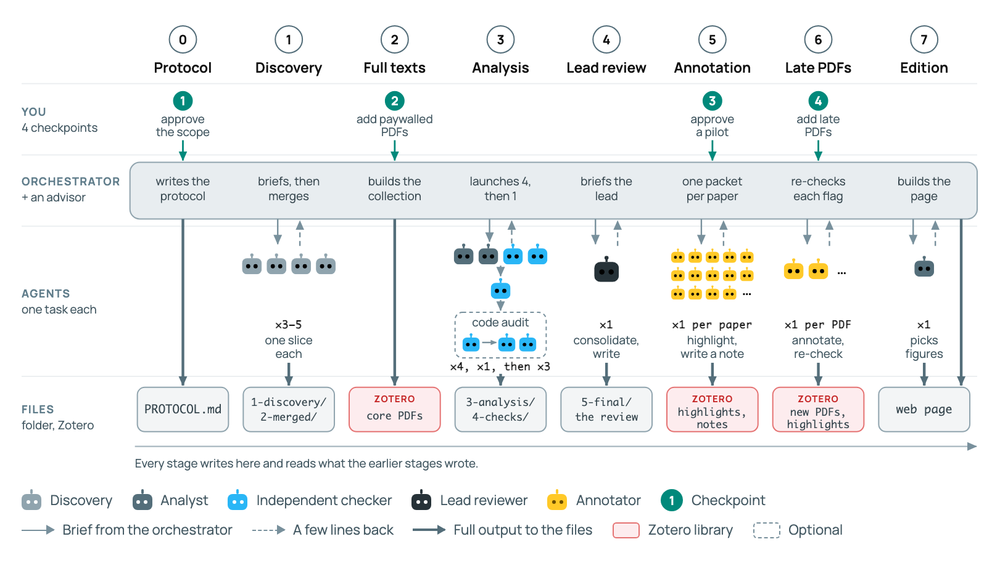
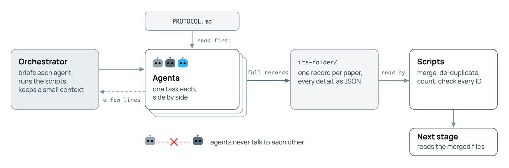
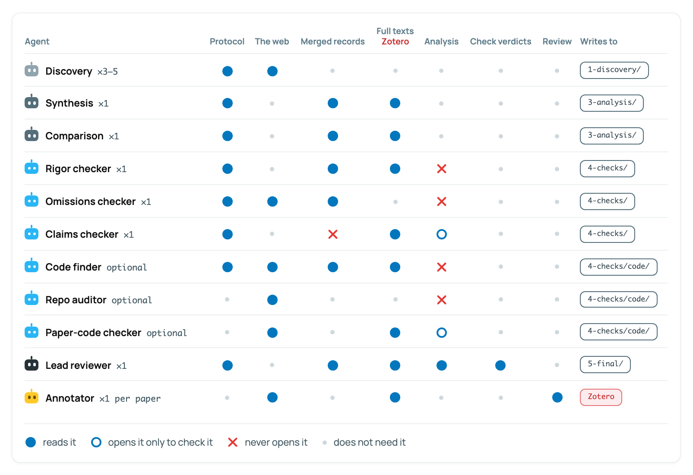
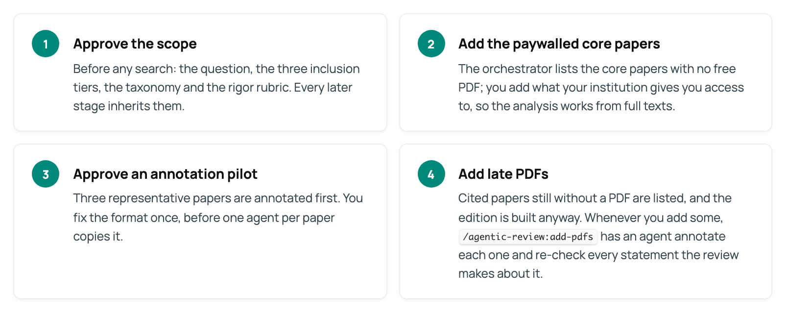

<p align="center">
  <picture>
    <source media="(prefers-color-scheme: dark)" srcset="docs/assets/lockup-dark.png">
    
  </picture>
</p>

<p align="center">
  <b>A Claude Code plugin that runs a critical literature review with a team of AI agents,</b><br>
  checks their work against the papers, and ties every statement to its highlighted passage in Zotero.
</p>

<p align="center">
  <a href="https://titouanlegourrierec.github.io/agentic-review/"><b>See how it works →</b></a>
</p>

<p align="center">
  <a href="https://github.com/titouanlegourrierec/agentic-review/actions/workflows/tests.yml"></a>
  <a href="https://github.com/titouanlegourrierec/agentic-review/releases"></a>
  <a href="https://code.claude.com/docs/en/plugins"></a>
  <a href="LICENSE"></a>
</p>



One orchestrator turns your question into a shared protocol and launches specialised agents in stages:
discovery agents search the field in parallel, analysts write the synthesis and the methodology comparison,
independent checkers score rigor, hunt for missed papers and verify every number against the papers themselves,
and a lead reviewer writes the critical review. Then one agent per cited paper files it in Zotero and highlights the
passage behind each statement. You decide at four checkpoints; everything else runs on its own.

## Features

- **A critical review**: scope and method with real search counts, taxonomy, key approaches, evidence and rigor,
  limitations, research gaps and recommendations; a catalogue of every paper, rigor scores and a BibTeX file.
- **Independent checks**: agents that never see the analysis they are compared with, and a claims checker that judges
  every number against the paper, not against another agent's notes.
- **A Zotero library**: a subcollection per theme, colour-coded highlights and one note per paper.
- **A reading edition**: one offline web page where each citation opens its passage in Zotero, with figures drawn by
  script from the review's own numbers.
- **A code audit**, if you want one: each paper's repository, a reproducibility score, and the analysis checked
  against the code, with links to the lines.
- **A package to share**: the edition and the cited PDFs in one zip, with a viewer that shows the same highlights,
  for colleagues without Zotero.
- **Rules enforced, not only stated**: hooks guard who reads what, block requests that carry your email address and
  refuse any Zotero call that deletes; files that do not validate are sent back.
- **Autonomous mode**, optional: the orchestrator decides at the checkpoints and logs every decision for you.

<table>
  <tr>
    <td width="33%"></td>
    <td width="33%"></td>
    <td width="33%"></td>
  </tr>
  <tr>
    <td align="center">How information moves</td>
    <td align="center">Who reads what</td>
    <td align="center">Where you decide</td>
  </tr>
</table>

## Install

You need [Claude Code](https://code.claude.com/docs/en/overview) and Python 3.9 or newer. Optional:
[Zotero 7](https://www.zotero.org/download/) with a Zotero MCP server that can write, such as
[zotero-mcp](https://github.com/54yyyu/zotero-mcp) (without it the review still runs); the
[GitHub CLI](https://cli.github.com/) for the code audit; Chrome for the reading edition.

```bash
claude plugin marketplace add titouanlegourrierec/agentic-review
claude plugin install agentic-review@agentic-review
```

Each [release](https://github.com/titouanlegourrierec/agentic-review/releases) also has the plugin as a
zip, to install from a local folder ([Usage](docs/usage.md#install)).

## Use

In an empty folder for the review, start Claude Code and type:

| Command | What it does |
|---|---|
| `/agentic-review:new [topic]` | Asks the settings, writes the protocol and stops at the first checkpoint |
| `/agentic-review:run` | Runs the next phases up to the next checkpoint; resumes an interrupted review. `run 3b` runs the code audit alone, `run 7` rebuilds the reading edition |
| `/agentic-review:status` | Where the review stands and what waits for you |
| `/agentic-review:add-pdfs` | After you add paywalled PDFs to Zotero: annotates them and re-checks every statement about them |
| `/agentic-review:share` | Packs the reading edition and the cited PDFs into one zip |

A `mini` scale (three discovery agents, a shorter review) is a good first try. [Usage](docs/usage.md) covers the
settings, autonomous mode and sharing.

## How it works

Agents never talk to each other. The orchestrator sends each one a brief, the agent reads the protocol, writes its
full output to its own folder and answers in a few lines; Python scripts merge, count and check the files, and the
next stage reads them. That keeps the orchestrator's context small enough to coordinate hundreds of agents in one
session. [How it works](docs/how-it-works.md) has the phases, the checks and the hooks, and the
[page on my site](https://titouanlegourrierec.github.io/agentic-review/) shows each agent's brief.

## Documentation

All of it is in [`docs/`](docs/README.md): usage, how it works, development and what has been verified. The
plugin's contract (files, record schema, scripts) is [`CONTRACT.md`](plugins/agentic-review/CONTRACT.md).

## Contributing

Bug reports and ideas are welcome as
[issues](https://github.com/titouanlegourrierec/agentic-review/issues);
[Development](docs/development.md) explains the layout and the tests.

## License

[MIT](LICENSE). The shared package's viewer uses [PDF.js](https://mozilla.github.io/pdf.js/) (Apache 2.0, in
[`lib/edition/vendor/pdfjs/`](plugins/agentic-review/lib/edition/vendor/pdfjs)).
