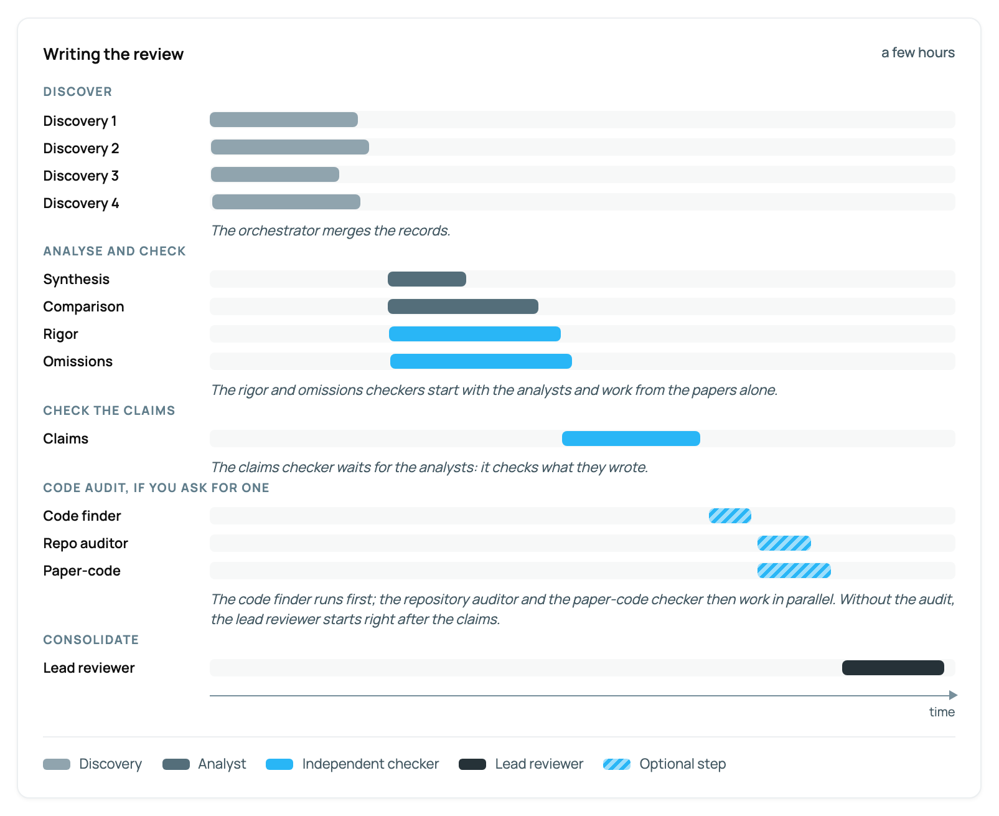

# How it works

## Phases and checkpoints

| Phase | Agents | You decide |
|---|---|---|
| 0 Protocol | the orchestrator | **1** approve the scope, tiers, taxonomy and rubric |
| 1 Discovery | `discovery` ×3–5 in parallel, one slice each, one of them chasing citations | |
| 2 Full texts | the orchestrator, through Zotero | **2** add the paywalled core PDFs |
| 3 Analysis and checks | `synthesis`, `comparison`, `rigor-checker`, `omissions-checker`, then `claims-checker` | |
| 3b Code audit (optional) | `code-finder`, then `repo-auditor` and `paper-code-checker` in parallel | |
| 4 Lead review | `lead-reviewer` | |
| 5 Annotation | `annotator`, one per cited paper, a few at a time | **3** approve a three-paper pilot |
| 6 Late PDFs | `late-pdf-checker`, one per PDF you add | **4** add PDFs whenever you get them |
| 7 Reading edition | the orchestrator by script, and `figure-designer` | |

Checkpoints 1 to 3 stop the run until you answer. Checkpoint 4 holds nothing up: the edition is built anyway and
rebuilt after each `/agentic-review:add-pdfs`. Without Zotero, only checkpoint 1 remains. For scale: the original
run of this method catalogued 284 papers and cited and annotated 151, with 210 agents; a `mini` review ran 9 agents
in about an hour and a half.

## Files, not conversation

Agents never talk to each other. Each one gets a brief (its agent file in
[`agents/`](../plugins/agentic-review/agents) plus what is specific to this run), reads `PROTOCOL.md`, writes its
full output to its own folder, and answers the orchestrator in at most 150 words. Scripts in
[`bin/`](../plugins/agentic-review/bin) do the mechanical work: merge and de-duplicate records, resolve DOIs and
arXiv IDs, count, build the citation map and the BibTeX file, cut the review into one packet per cited paper, and
check every file against the schema. Every number the orchestrator reports comes from a script.

When sources disagree, the lead reviewer follows a fixed order: claim verdicts, then record corrections, then the
synthesis and comparison prose, then discovery notes.

## Independent checks

The rigor and omissions checkers never open the analysis they will be compared with; the omissions checker
searches with its own strategy. The claims checker judges every number and reference against the paper itself, and
returns each claim as supported, partly supported (with the right setting) or contradicted. In the code audit, the
paper-code checker reads the analysis only to test its implementation claims against the code, at a pinned commit,
and the lead reviewer reports each difference as a "Reviewer:" note linked to the lines.

## Hooks

Hooks (in [`hooks/`](../plugins/agentic-review/hooks)) act only inside a review folder:

- **Who reads what**: each agent may read and write only what [`access.json`](../plugins/agentic-review/hooks/access.json)
  allows. It is a guard against mistakes, not a sandbox: Bash commands are checked only for denied paths written
  out in full.
- **No personal data in requests**: a network call that carries an email address or an `email=` parameter is
  blocked, for every agent.
- **Zotero**: any call that deletes, trashes, removes or merges is refused, and so is replacing an item's tags or
  collections; the add tool must not use its own PDF lookup, which queries Unpaywall.
- **Valid hand-offs**: when an agent finishes, its JSONL files must parse and match the schema, or it is sent back.
- **State**: phases and checkpoints live in `state.json`, written only by `ar-state`; a phase after an unapproved
  checkpoint does not start.

## The reading edition

`ar-edition` turns the review into one self-contained page: contents, headline numbers, key points, figures,
hover previews, a glossary, the rigor table, the catalogue and a BibTeX download, in light and dark themes. With
Zotero, each citation opens the paper at the highlight that supports it (`zotero://open-pdf/…?annotation=…`) and
hovering shows the highlighted text. PDF readers drop these links, so there is no PDF edition.

Figures are data, not drawings: the `figure-designer` agent writes each one as a specification, a script draws it,
and any number the review does not state is refused. Examples to adapt are in
[`templates/figures/`](../plugins/agentic-review/templates/figures).
